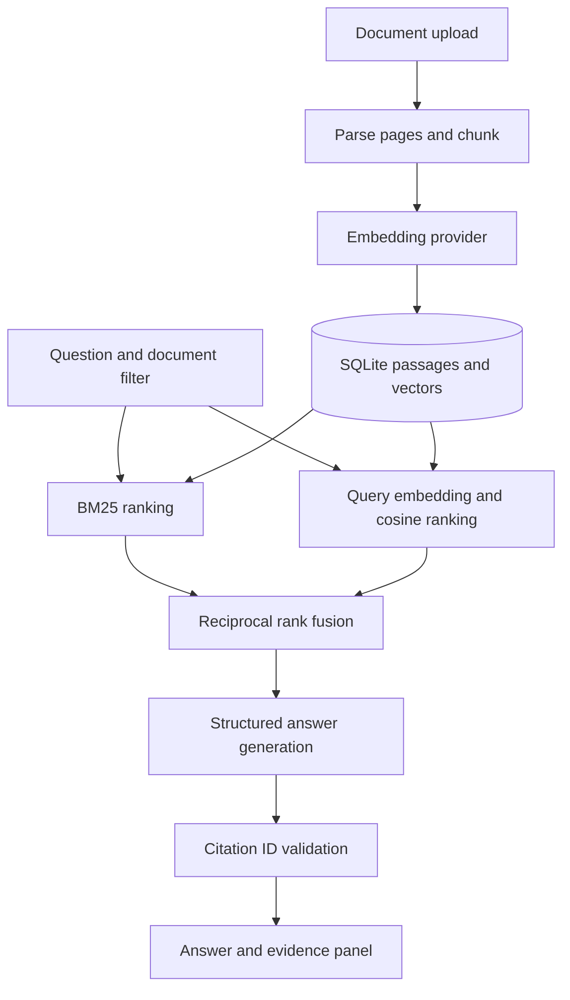

# Grounded

**A document research assistant that shows the evidence behind its answers.**

Upload a PDF, Markdown file, or text document, ask a question, and inspect the passages used to answer it. Grounded combines BM25 keyword retrieval with vector similarity, supports local or hosted LLMs, and includes a reproducible retrieval benchmark.

Built as an inspectable portfolio project: the retrieval algorithm, storage layer, provider adapters, and evaluation code are small enough to explain in an interview.

**Stack:** Python · FastAPI · SQLite · NumPy · Ollama / OpenAI · HTML/CSS/JavaScript · Docker · GitHub Actions

## Start here

Requirements: Python 3.11–3.13. Run commands from this folder. Internet is needed once to install Python dependencies. No Node build step is required.

```bash
python -m venv .venv
source .venv/bin/activate
python -m pip install -r requirements.txt
cp .env.example .env
python -m grounded ingest samples
python -m grounded serve
```

On Windows PowerShell, replace the activation and copy commands with:

```powershell
.venv\Scripts\Activate.ps1
Copy-Item .env.example .env
```

Open **http://127.0.0.1:8000**. Interactive API documentation is at **http://127.0.0.1:8000/docs**.

Try: “What is the procedure for a production rollback?” or “How long are backups retained?” The six included documents describe a fictional engineering organization, Northstar.

**The default `demo` mode is an extractive preview, not an LLM.** It runs without model downloads or API credentials. It uses lexical feature hashes and returns matching sentences verbatim. For a resume demo of actual RAG with an LLM, complete one of the next two setups.

## Run with a real local LLM

Install [Ollama](https://ollama.com/download), start it, and pull both models:

```bash
ollama pull qwen2.5:3b
ollama pull nomic-embed-text
```

If Ollama is not already running as a desktop service, run `ollama serve` in another terminal. Model downloads require internet and several GB of disk space. Inference speed and memory requirements depend on your machine and context size; smaller hardware may need a smaller model.

Edit these entries in `.env`:

```dotenv
RAG_PROVIDER=ollama
RAG_CHAT_MODEL=qwen2.5:3b
RAG_EMBED_MODEL=nomic-embed-text
RAG_OLLAMA_URL=http://127.0.0.1:11434
```

Then re-ingest and restart:

```bash
python -m grounded ingest samples
python -m grounded ask "How long are backups retained?"
python -m grounded serve
```

Ollama now provides both neural embeddings and structured LLM answers. Once the models are downloaded, this configuration can run offline when Ollama is on the same machine. For the bundled Nomic model, the adapter uses `search_document:` and `search_query:` prefixes.

**Each provider / embedding model / chunk configuration has its own index.** Switching configurations starts a separate index; re-ingest your documents. Changing only the chat model does not require re-embedding. If you replace a model's weights under the same model name, use a new `RAG_DATA_DIR` and re-ingest.

## Run with OpenAI

Edit `.env` with your own API key and a model available to your account:

```dotenv
RAG_PROVIDER=openai
RAG_CHAT_MODEL=gpt-4.1-mini
RAG_EMBED_MODEL=text-embedding-3-small
OPENAI_API_KEY=your-key-here
```

Run the same ingestion and startup commands. This adapter calls the embeddings endpoint and the Responses API with a JSON schema. API calls incur usage charges. Document chunks are sent for embedding; questions and retrieved passages are sent for answer generation. Keys stay on the backend and are excluded from the repository and container build context. `store=false` is set on Responses requests; this is not a claim about all provider retention policies.

The model names are configurable examples, not a guarantee of future availability. Use a Responses-compatible model with structured output support. If your environment uses a SOCKS proxy, install the optional HTTP transport dependency with `python -m pip install 'httpx[socks]==0.28.1'`.

## What is included

- PDF/text/Markdown ingestion with page metadata, overlapping chunks, file hashing, and duplicate detection.
- Persistent SQLite document and vector storage; transactional ingestion and cascading deletion.
- BM25 retrieval, exact cosine retrieval, and reciprocal rank fusion; selectable method and document filters.
- Ollama and OpenAI adapters with normalized embeddings, bounded requests, structured answers, and token counts.
- Per-claim source references; unknown citation IDs cause abstention instead of displaying the answer.
- A responsive research UI with upload, source selection, evidence cards, retrieval scores, and Markdown export.
- CLI commands, typed REST endpoints, request IDs, timing metrics, and optional shared-token access.
- A 24-question evaluation set, strategy comparison, 42 automated tests, optional browser test, and CI configuration.
- Dockerfile, Compose configuration, sample corpus, architecture notes, demo script, and resume/interview guide.

## Architecture



| Module | Responsibility |
|---|---|
| `grounded/ingestion.py` | Parse documents; preserve page numbers; make overlapping chunks |
| `grounded/store.py` | SQLite persistence, atomic writes, document deletion |
| `grounded/retrieval.py` | Tokenization, BM25, cosine scoring, rank fusion, relevance gate |
| `grounded/providers.py` | Demo, Ollama, and OpenAI embedding/generation adapters |
| `grounded/service.py` | Orchestrate ingestion, retrieval, generation, citation checks |
| `grounded/api.py` | REST API, request size limits, optional authentication, static UI |
| `grounded/evaluate.py` | Build a fresh evaluation index and compare strategies |
| `grounded/web/` | Browser interface; no frontend dependencies |
| `tests/` | Unit, integration, HTTP contract, and failure-path tests |
| `docs/` | Design decisions, portfolio presentation, validation record |

Read [the design notes](docs/ARCHITECTURE.md) for the algorithms and tradeoffs.

## Evaluation

The evaluation command reads `.env`, builds a new temporary index from `samples/`, and deletes that temporary index afterward. It never evaluates against private files uploaded to the app.

```bash
# Retrieval only; embeddings may still incur cost in OpenAI mode.
python -m grounded.evaluate --output reports/retrieval.json

# Retrieval + generation: 24 cases × 3 strategies, with generation skipped for empty retrieval.
python -m grounded.evaluate --generate --output reports/full.json

# Compare a smaller retrieval depth.
python -m grounded.evaluate --top-k 3 --output reports/top3.json
```

The included development fixture has **16 answerable questions and 8 unanswerable questions**. Four negatives are off topic and four are plausible questions whose answers are absent. Gold labels require both the correct filename and an exact supporting phrase in a retrieved passage. Two questions require multiple pieces of evidence.

| Metric | Definition |
|---|---|
| Evidence Recall@k | Average fraction of required gold evidence items retrieved for answerable questions |
| MRR@k | Average reciprocal rank of the first relevant passage for answerable questions |
| Retrieval abstention specificity | Fraction of unanswerable questions with no retrieved passages |
| Answerable coverage | Fraction of answerable questions receiving passages, or answers when generation is enabled |
| Answer abstention specificity | Fraction of unanswerable questions the generator declines to answer |
| Citation validity | Fraction of displayed answers whose source IDs exist in the retrieved context |
| p50 / p95 latency | Observed per-query elapsed time; includes generation only with `--generate` |

### Included measured results

These results were actually produced by `demo` mode on the bundled six-document, twelve-passage corpus. The complete per-case output is [reports/demo-benchmark.json](reports/demo-benchmark.json).

| Strategy | Evidence Recall@5 | MRR@5 | Unanswerable refusal rate |
|---|---:|---:|---:|
| BM25 | 1.000 | 0.969 | 37.5% |
| Hash-vector cosine | 1.000 | 0.938 | 37.5% |
| Hybrid | 1.000 | 0.969 | 37.5% |

These numbers are **not neural retrieval results, LLM accuracy, or production benchmarks**. The tiny corpus and development questions make high retrieval recall easy. The low refusal rate is a visible limitation of lexical/extractive mode, particularly on near-topic negatives. Hybrid did not outperform BM25 on this fixture. Citation-ID validity is structurally enforced and does not establish factual support.

For stronger resume evidence, create a separate held-out set from your own corpus, run the real LLM configuration, manually review answer correctness and claim support, and report the corpus size, model, hardware, and latency alongside quality metrics. Keep development and held-out questions separate when tuning thresholds.

## Tests

```bash
python -m unittest discover -s tests -v
```

The suite exercises real parsing, indexing, retrieval, API validation, size limits, duplicate uploads, concurrent inserts, deletion, persistence, citation rejection, malformed provider responses, and mocked HTTP contracts for both LLM providers. No API key or model server is needed.

Optional browser integration check:

```bash
python -m pip install -r requirements-dev.txt
python -m playwright install chromium
python scripts/ui_smoke.py
```

The browser script creates a disposable index and checks questions, citation navigation, export, uploads, document filters, text-safe rendering, and mobile width. GitHub Actions includes this job and Python 3.11–3.13 API/core jobs. See [VALIDATION.md](docs/VALIDATION.md) for which checks were executed when this project was delivered.

## Docker

For the extractive preview:

```bash
docker compose up -d --build
docker compose exec app python -m grounded ingest samples
```

For local LLM mode, set the Ollama entries in `.env`, then:

```bash
docker compose --profile local up -d --build
docker compose exec ollama ollama pull qwen2.5:3b
docker compose exec ollama ollama pull nomic-embed-text
docker compose exec app python -m grounded ingest samples
```

The app connects to `http://ollama:11434` inside Compose. The Ollama container is CPU-only in this configuration; GPU setup is machine-specific. The service listens on localhost port 8000 and persists indexes in a named volume. `docker compose down` stops services while keeping data. Do not add `-v` unless you intend to delete the volumes.

The container runs as a non-root user with a read-only filesystem and a writable data volume. Docker files are included but were not executed in the delivery environment. The Ollama image uses `latest` for convenience; pin a verified image digest before using a repeatable deployment.

## API and CLI

| Method | Route | Purpose |
|---|---|---|
| GET | `/health` | Process liveness; does not test the model server |
| GET | `/api/config` | Non-secret provider and index settings |
| GET | `/api/documents` | List indexed documents and chunk counts |
| POST | `/api/documents` | Upload a multipart field named `file` |
| DELETE | `/api/documents/{id}` | Remove a document and all its indexed passages |
| POST | `/api/search` | Retrieve passages without generation |
| POST | `/api/ask` | Return an answer, source passages, timings, and usage |

```bash
curl -X POST http://127.0.0.1:8000/api/ask \
  -H 'Content-Type: application/json' \
  -d '{"question":"How long are backups retained?","strategy":"hybrid","top_k":5}'

python -m grounded ingest /path/to/documents
python -m grounded ask "What is the rollback procedure?" --strategy hybrid
python -m grounded documents
```

Set `RAG_API_TOKEN` to protect `/api/*`, then add `Authorization: Bearer YOUR_TOKEN` to API requests or enter the token under **Access token** in the UI. It stays in the tab's memory. The health route, static UI, and API schema remain public. Mobile users can expand **Search settings**. A shared token is a small-project access gate, not individual user accounts or tenant isolation.

Questions are standalone. Earlier questions are not sent as conversation history. Include the relevant subject explicitly when asking a follow-up.

## Configuration and limits

| Setting | Default | Purpose |
|---|---|---|
| `RAG_PROVIDER` | `demo` | `demo`, `ollama`, or `openai` |
| `RAG_DATA_DIR` | `./data` | Persistent SQLite index directory |
| `RAG_CHAT_MODEL` | `qwen2.5:3b` | Generation model; set a compatible OpenAI model in OpenAI mode |
| `RAG_EMBED_MODEL` | `nomic-embed-text` | Neural embedding model; ignored in demo mode |
| `RAG_CHUNK_WORDS` | `220` | Maximum words per passage; accepted range 40–500 |
| `RAG_CHUNK_OVERLAP` | `40` | Overlapping words; must be smaller than chunk size |
| `RAG_TOP_K` | `5` | Default CLI/UI retrieval depth; API request default is 5 |
| `RAG_MIN_SIMILARITY` | `0.35` | Neural cosine threshold; a heuristic requiring corpus-specific tuning |
| `RAG_MAX_UPLOAD_BYTES` | `10485760` | 10 MiB per file |
| `RAG_MAX_DOCUMENT_CHARS` | `500000` | Maximum extracted characters per document |
| `RAG_MAX_CHUNKS` | `10000` | Maximum passages per index |
| `RAG_REQUEST_TIMEOUT` | `120` | Timeout in seconds for each provider HTTP operation |
| `RAG_API_TOKEN` | Empty | Optional shared token |

PDFs are limited to 200 pages. Scanned documents require external OCR; encrypted PDFs are rejected. Chunks also have a 6,000-character ceiling. This is not exact model token accounting; dense non-English text or large retrieval contexts may still require a smaller chunk size / top-k for the selected model.

## Scope and next steps

This is a complete **single-user portfolio application**, not a hardened public document-hosting service. SQLite and exact vector scans make setup simple and algorithms inspectable. Both retrieval branches scan the selected corpus, so query work grows with the number of passages. The 10,000-passage cap is a guard, not a measured throughput target.

Before exposing this app to untrusted users, add per-user authorization, rate limiting, parser isolation, network/time/resource budgets, TLS, and operational monitoring. Parsing and embedding are synchronous jobs in worker threads; high-volume ingestion needs a task queue. Uploaded PDFs can still consume significant parser memory. Document content is stored unencrypted in SQLite. Deletion removes indexed rows, but does not promise forensic erasure from SQLite journals, backups, or old provider-specific indexes.

Prompt instructions treat evidence as untrusted, and the UI renders model/source text as text rather than HTML. Those controls reduce specific risks; they do not prove prompt-injection resistance. The model can still make unsupported claims with valid citation IDs. There is no entailment verifier, reranker, OCR, ANN vector database, streaming output, or multi-turn query rewriting in this version.

Good extensions include pgvector/HNSW for large indexes, cross-encoder reranking, a human-labeled factual support benchmark, authenticated collections, and asynchronous ingestion. Choose one extension you can measure and explain.

## Present it on your resume

See [RESUME_AND_INTERVIEW.md](docs/RESUME_AND_INTERVIEW.md) for honest resume bullets, a five-minute demonstration, interview questions, and a plan for making the project your own. Understand and customize the code before claiming it as your experience. Use only measurements you reproduce.

## API references

Provider integrations were checked against the official documentation:

- [Ollama embeddings endpoint](https://docs.ollama.com/api/embed)
- [Ollama chat endpoint and structured format](https://docs.ollama.com/api/chat)
- [Nomic embedding model and task prefixes](https://huggingface.co/nomic-ai/nomic-embed-text-v1.5)
- [OpenAI structured outputs](https://developers.openai.com/api/docs/guides/structured-outputs)
- [OpenAI embeddings](https://developers.openai.com/api/reference/resources/embeddings/methods/create)
- [FastAPI file uploads](https://fastapi.tiangolo.com/tutorial/request-files/)

MIT licensed. The sample corpus was written for this project and contains no real organizational policies or customer data.
